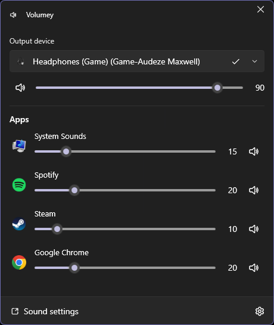

<h3 align="center">
   
  
   
  Volumey
</h3>
<h4 align="center">
  A volume mixer for Windows with global hotkeys for every app and device.
   
   
  
  
  
   
   
  
   
</h4>

## Features
### Hotkeys
- **Any app:** turn a chosen app's volume up or down
- **Foreground app:** control whichever app is in focus
- **Output device:** change the volume of the default device or mute it
- **Default device:** switch to another output device with one key
- **Media keys:** play/pause, previous, next and stop
- **Mixer:** open the volume mixer
- **Two modes:** keep the keys to Volumey, or share them with other apps (handy in games)
- **Your step:** pick how much each press changes the volume

### Volume mixer
- Opens from the tray icon or by a hotkey
- A compact pop-up next to the tray or a resizable window
- Volume and mute for every app, each of its audio sessions and the output device

### More
- **On-screen notifications** in the corner of the screen you choose
- **Volume limit:** apps that start at 100% start at your preferred volume instead
- **Volume sync:** keep app volumes in step with the device volume

## Preview

  

## Download
- [Microsoft Store](https://www.microsoft.com/store/apps/9mzcq03mx0s3)
- [GitHub Releases](https://github.com/G-Stas/Volumey/releases)

## Supported OS
`Windows 11` `Windows 10 19041.0+`

## Built With
- [WPF UI](https://github.com/lepoco/wpfui)
- [NAudio](https://github.com/naudio/NAudio)
- [SharpHook](https://github.com/TolikPylypchuk/SharpHook)
- [H.NotifyIcon](https://github.com/HavenDV/H.NotifyIcon)
- [AutoUpdater.NET](https://github.com/ravibpatel/AutoUpdater.NET)

## License
Volumey is released under the [GPL-3.0 License](https://github.com/G-Stas/Volumey/blob/main/LICENSE).
